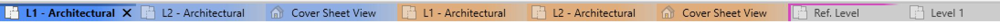
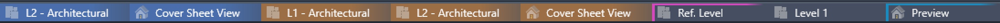
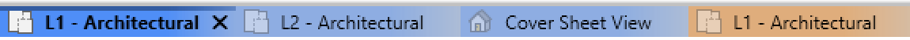
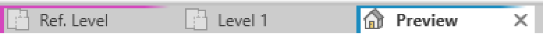
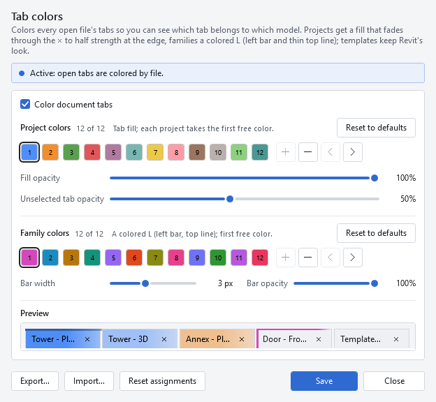
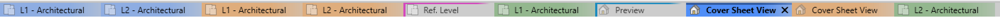
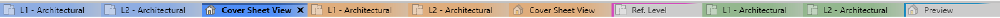

# Splash-It

**Splash-It** is a Revit add-in by Designs/OS that colors your view tabs by file. With several models and families open, you can tell at a glance which tab belongs to which, and one click puts each file's tabs back together. It is a sister app of [Gantt-It](https://github.com/jedbjorn/gantt-it).

## What it does

- **Projects** (`.rvt`) get a color fill. It is solid from the tab's left edge, then fades through the close × to half strength at the right edge, so a project's tabs join with no gap. The selected tab is at full strength with a darker line along its top. The project's other tabs are at 50 % by default, so the view you're in stands out.

  

- **Families** (`.rfa`), including one opened with **Edit Family**, get a colored L: a bar down the tab's left edge, 1 to 6 px wide, and a thin line along its top that fades out to the right.

  

- **Templates** (`.rte`, `.rft`) keep Revit's own look.
- Every tab of a file shares its color: views, sheets and schedules alike.
- Each file you open takes the first free color in its list, and keeps it until you close it. Projects and families each have their own list of up to 12 colors. With more files open than colors, colors repeat.
- Titles and the × turn black or white, whichever reads better on the color, in Revit's light and dark themes.
- It never changes your models. It only restyles the tabs.

## Settings

Click **Splash-It** on the **Add-Ins** tab to choose your colors and how strong they are:

- Edit any color from a palette, by color code, or straight from the screen. Add, remove and reorder up to 12 colors in each list.
- Set the fill opacity and the unselected tab opacity for projects, and the bar width and bar opacity for families.
- Watch the preview change as you go. **Save** restyles your open tabs at once.
- **Export…** your colors to a file, and **Import…** someone else's, to share a look with your team.
- **Reset assignments** hands out the colors again from the start of each list.
- Untick **Color document tabs** to turn the coloring off. Your tabs go back to Revit's look.

The window follows Revit's light or dark theme.

## Group tabs by file

Revit adds each new view tab at the end of the strip, so after a while one file's tabs are scattered among the others. Click **Group Tabs**, next to the Splash-It button on the **Add-Ins** tab, to put each file's tabs together.

Before:

After one click:

- The file you're working in comes first. The other files follow in the order of their leftmost tab.
- A file's tabs keep their order among themselves, and the selected view stays the same.
- Every kind of file is grouped, colored or not. A tab Splash-It can't match to an open file goes after the grouped tabs.
- With tiled or split views, each pane is grouped on its own, and no tab moves to another pane. Views in floating windows are left alone.
- It sorts once, when you click, and never on its own, so you can still drag tabs anywhere afterwards. When the tabs are already grouped, nothing happens.
- It works with the coloring on or off.

To give it a keyboard shortcut, open Revit's **View › User Interface › Keyboard Shortcuts** and search for "Group Tabs".

Group Tabs only changes the order of the tabs. It doesn't touch your model, and there is nothing to undo. If a Revit update changes the tab strip in a way Splash-It doesn't expect, it says "Splash-It can't group tabs on this Revit build" and leaves the tabs as they are.

## Install

<!-- Adapted from gantt-it README.md, "Install" (gantt-it commit aa83f35). -->

1. Download `SplashIt-<version>.msi` from the [latest release](https://github.com/jedbjorn/splash-it/releases/latest).
2. Close Revit, then run the file.
3. If Windows says "Windows protected your PC", choose **More info**, then **Run anyway**. Windows asks this because Splash-It is not digitally signed yet. That is expected.
4. Accept the licence and click **Install**. The installer adds Splash-It to each Revit 2025, 2026 and 2027 it finds on your computer. It installs for you only and needs no administrator rights. If it finds none of them, it stops and says so.
5. Start Revit. Revit asks whether to load Splash-It, for the same reason: choose **Always Load**.

Your tabs are now colored by file, and the **Splash-It** button on the **Add-Ins** tab opens its settings.

**Upgrade:** close Revit, then run the newer installer. It replaces the old version. Revit asks again whether to load Splash-It on the next start: choose **Always Load** again.

**Installed another Revit year later?** Close Revit, run the installer again and choose **Repair**. It adds Splash-It to the Revit you just installed.

**Uninstall:** close Revit, then:

- Windows 11: **Settings › Apps › Installed apps**, find **Splash-It**, open its **⋯** menu and choose **Uninstall**.
- Windows 10: **Settings › Apps › Apps & features**, select **Splash-It** and choose **Uninstall**.

Uninstalling leaves two things behind: your settings in `%AppData%\SplashIt\settings.json` (your colors and choices; reinstalling picks them up again), and Splash-It's log files in `%LocalAppData%\SplashIt\logs`. To remove them as well, delete the `%AppData%\SplashIt` and `%LocalAppData%\SplashIt` folders.

**For IT:** close Revit, then run `msiexec /i SplashIt-<version>.msi /qn /norestart` in the user's own context. It installs for that user only, not when run as SYSTEM. It exits with 1603 when no Revit 2025, 2026 or 2027 is found, and can end with 3010 (restart needed) if Revit was open. To add a Revit year installed later, run `msiexec /i SplashIt-<version>.msi REINSTALL=ALL REINSTALLMODE=ecmus /qn /norestart`; installing the same MSI again does not. Details, including the exit codes for setup bundles that chain this installer, are in [docs/RELEASING.md](docs/RELEASING.md#silent-install-and-chaining).

## Compatibility

- Revit 2025, 2026 and 2027, on Windows. Older versions of Revit are not supported.
- **pyRevit:** if pyRevit's own tab coloring is running, Splash-It stays off so the two don't fight over your tabs, and its settings window says so. To use Splash-It instead, turn off pyRevit's tab coloring and restart Revit.

## License

Splash-It is released under the [MIT License](LICENSE). Copyright (c) 2026 Designs/OS.

---

For developers: building and testing are in [docs/DEVELOPING.md](docs/DEVELOPING.md), releases in [docs/RELEASING.md](docs/RELEASING.md).
