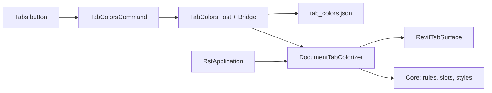

# Splash-It — handoff from rst-c (2026-10-29)

From: rst-c Planner-01 (PLN1). For: the splash-it repo's planner, to author splash-it's first spec in its own DB.

Source: rst-c feature #12 / spec #14 "Document Tab Coloring" (now retired in rst-c). rst-c decisions: #3, superseded by #4.
The original spec body follows the revision list below. **The revisions win wherever they conflict with it.**

## Revisions agreed with the FnB (jed), 2026-10-29

1. **Own add-in, own repo, own installer.** Splash-It lives in `jedbjorn/splash-it` and ships its own per-user MSI. It is also bundled in rst-c's `RST.msi`.
2. **Single-copy rule.** The standalone MSI and `RST.msi` must install identical files to the identical path under the same `.addin` ClientId, so Windows Installer treats them as one shared install and Revit never loads Splash-It twice. Settle the exact path and component identity with rst-c's bundling feature (#13 in rst-c's roadmap). Gantt-It needs the same rule.
3. **Native WPF, no WebView2.** Replace the `tab_colors.html` / bridge / host design with a WPF window and view-models, built the way gantt-it is (`GanttIt.Revit/UI/`: MVVM with plain `INotifyPropertyChanged`, a modal window owned by Revit's main window, a `DialogService`, a color picker).
4. **gantt-it's look, light and dark.** Use gantt-it's `Theme.xaml` tokens and control styles. gantt-it is adding dark mode now; Splash-It follows Revit's theme (`UIThemeManager.CurrentTheme`, plus `ThemeChanged`) in the same way gantt-it does once that lands. Keep the two in step (how the theme is shared, vendored copy or package, is still open).
5. **gantt-it's architecture.** Use `SplashIt.Core` (net8.0;net10.0, no Revit, no WPF), with the pure model: config, rules, slots, style catalogue, color math. Add `SplashIt.Revit` (the `$(RevitTargetFramework)` add-in) and `tests/SplashIt.Core.Tests`. Use the rst-c/gantt-it build pattern (`Debug|Release R25|R26|R27`), the `Nice3point.Revit.Api.*` reference packages, and only .NET's built-in libraries plus WPF as dependencies.
6. **Ribbon.** A "Splash-It" panel on the built-in Add-Ins tab with one button. This replaces the spec's fifth "Tabs" button on the RST panel. Icons follow gantt-it §8.2 / rst-c (32/16 px, `#D9D9D9` tile, `#4F8EF7` glyph).
7. **Identity and storage.** VendorId `DSOS`. Settings move out of `%AppData%\RST\` into Splash-It's own per-user folder. There are no `RST.Core` dependencies (`AppDataPaths`, Serilog, `RstApplication` wiring): Splash-It has its own `IExternalApplication` with startup and shutdown, and logging that uses only built-in .NET (no Serilog).
8. **Unchanged:** coloring behavior (per-document palette slots, wrap on exhaustion, case-insensitive title rules with a 100 ms timeout, nine styles, a separate family style, default off), the clean-room boundary (pyRevit is GPL-3.0; no code may be copied), the single class that touches Revit's internal tab tree with its `Unavailable` fallback, the hot-path signature check, self-stop after 3 faults, the pyRevit coexistence guard, out-of-scope items, Anticipated User Activity, and the AC9 in-Revit checklist. That check stays pending until the W10C_DOS-ARCH_Testing VM is free.
9. **Acceptance seats change.** The WebView2 bridge criteria (AC6/AC7) become view-model tests plus WPF window screenshots. The AC4/AC5 Windows runtime tests need a Windows CI job in splash-it's repo; gantt-it currently has only Linux Core tests plus builds.

---

---
title: Document Tab Coloring
tags: [addin, ribbon, webview2, tab-coloring, pyrevit-port]
date: 2026-10-28
project: addin
purpose: Color Revit view tabs by model
---

# Document Tab Coloring

## Overview

Roadmap feature #12 (Document Tab Coloring), work-stream `addin`.

pyRevit ships a **Tab Coloring** feature (its "document colorizer"). Every open model gets a color, and all of that model's view tabs show it, so a user with three models and twenty views open can tell at a glance which tab belongs to which model. Users like the feature. Getting it today means installing all of pyRevit, which is slow to load because of its Python/IronPython runtime, and its settings live in pyRevit's Python settings window.

This delivery puts the same feature into rst-c as native C# in the engine, with a WebView2 settings window. Nothing new loads at startup unless the user has turned it on.

```stats
:::class1
value: 9
label: Tab styles
description: Top bar ×4, outline ×4, fill
:::class2
value: 10
label: Default palette colors
description: Editable, add/remove/reorder
:::class3
value: 0
label: Python at runtime
description: Engine C# + WebView2 only
:::class4
value: Pending
label: In-Revit proof
description: VM busy — post-merge check (AC9)
```

> [!class1]
> FnB decisions of 2026-10-28: **D1** per-user settings only; **D2** a new **Tabs** button on the RST panel opens a WebView2 settings window; **D3** v1 matches pyRevit's features (palette, title rules, 9 styles, separate family style); **D4** merge on CI evidence while the in-Revit check stays explicitly pending until the VM is free.

## Current Posture

### rst-c today

- rst-c has no tab coloring. The closest existing feature is **coloured panels** (feature #4, `docs/appearance.md`). `RST.Engine/Ribbon/PanelStyling.cs` colors *ribbon panels* through the public-ish AdWindows API. Document tabs are a different surface and AdWindows does not reach them.
- `RibbonBuilder.Build` creates one permanent panel, `RST`, on the Add-Ins tab with four Large buttons: Builder, Loader, RSTify, Health. The comments call this "the four-button panel (RST-043)". Brand icons carry a `#d9d9d9` chip background so they read on both Revit themes. The buttons stay visible to the catalogue scanner so they can be placed on profile tabs.
- Every WebView2 window follows the same pattern: `XWindow.xaml.cs` (environment under `%LocalAppData%\RST\WebView2`, `https://rst.ui/` virtual host over `Assets/`, `pywebview-shim.js` injected, bridge registered as host object `api`), `XBridge` (string-in/string-out JSON methods), and `XHost.ShowModal(...)` taking callbacks so `RST.UI` never references Revit types. `HealthHost`/`HealthBridge` are the closest template. Shared UI assets: `rst_components.css`, `rst_messages.js`.
- Per-user state is JSON under roaming `%AppData%\RST\` (`AppDataPaths.Root`). Readers fall back to defaults when a file is missing or unreadable (`UserProfilePrefs.Read`). Tests redirect the root with `AppDataPaths.OverrideRootForTests`.
- `RstApplication` wires startup work at `ApplicationInitialized` and subscribes `ViewActivated`/`Idling` for the RSTify re-assert. It tears everything down in `OnShutdown`. Failures in optional subsystems are caught and logged, and never fail `OnStartup` (telemetry is the precedent).
- Tests: `RST.Tests` (`net8.0`, Linux CI) covers `RST.Core`. `RST.RuntimeTests` (`windows-latest`, WPF available, no Revit) covers `RST.UI`/`RST.Engine` internals through `InternalsVisibleTo`. `RST.IntegrationTests` runs on the VM seat and does not start Revit.

### How pyRevit does it (studied for behavior only)

- **Settings** (`[tabcoloring]` in pyRevit's ini): on/off; an ordered list of colors; a map of color → title regex ("filter rules"); a tab style index for project documents (default "Top Bar – Light") and one for family documents (default "Border – Light"); and a `sort_colorize_docs` flag. That flag is stored but has no effect in the C# runtime.
- **Runtime**: it subscribes to `DocumentOpened/Created/Closed` and to the main window's docking manager `LayoutUpdated`. On each layout pass it walks the visual tree for the document `TabItem`s and skips work when a tab-state signature is unchanged. It resolves each tab to its document through a non-public Revit pointer and replaces `TabItem.Style` with a derived style. Original styles are stored so turning it off restores them.
- **Color choice**: title rules are checked first and the first match wins. Otherwise a document takes the next free palette slot in open order and keeps it while open. Closing a document frees its slot. When the palette is exhausted and no slot is free, the tab is left uncolored.
- **Styles**: nine of them, varying border thickness, top bar vs full outline, and fill. Fill picks black or white text from the color's luminance. Hover and selected states use a lightened color.

> [!class4]
> **License boundary.** pyRevit is GPL-3.0 and rst-c is MIT. This is a clean-room reimplementation of *behavior*. No pyRevit source, including its C# runtime, may be copied, translated line-by-line, or vendored. This spec describes behavior; the Reviewer checks this (AC8).

### Consulted

- DB docs #5 (Appearance) and #2 (Profile Loader); `docs/appearance.md`, `README.md`; decisions #1–#2 (not binding here); spec #13 for the R27 and VM context.
- Code read: `RstApplication.cs`, `RibbonBuilder.cs`, `PanelStyling.cs` (header), `AppDataPaths.cs`, `UserProfilePrefs.cs`, `HealthCommand.cs`, `HealthHost.cs`, `HealthWindow.xaml.cs`, `HealthBridge.cs` (surface), `pywebview-shim.js`, `RST.Engine.csproj`, `Directory.Build.props`, `_build.yml`, `LoaderBridgeIconpackTests.cs`.
- pyRevit (`pyrevitlabs/pyRevit@develop`): `pyrevitlib/pyrevit/revit/tabs.py` and `dev/pyRevitLabs.PyRevit.Runtime/EventHandling.cs` (`TabColoringRule`, `TabColoringStyle`, `TabColoringTheme`, `DocumentTabEventUtils`). Read only to understand the behavior.

## Scope

### In Scope

- **Core model** (`RST.Core/TabColoring/`): config + JSON persistence, default palette, style catalogue, title-rule matching, slot allocation, and text contrast. All of it is pure and unit-testable.
- **Engine colorizer** (`RST.Engine/TabColoring/`): a lifecycle-managed colorizer that finds Revit's document tabs, resolves each tab's document, applies and restores styles, and reports status.
- **Settings window** (`RST.UI/TabColors/` + `Assets/tab_colors.html`) behind a new **Tabs** button (**D2**). Changes apply live.
- **Startup wiring**: the colorizer starts at `ApplicationInitialized` only when enabled and is torn down at `OnShutdown`.
- **pyRevit coexistence guard**: if pyRevit's colorizer is detected running, RST's colorizer does not start.
- New Tabs icons (16/32, `#d9d9d9` chip per RST-043). Update the "four-button" comments, `docs/appearance.md` (or a new `docs/tab-coloring.md`), and the README feature list.
- Unit + runtime tests per Acceptance Criteria.

### Out of Scope

- **Profile-carried or admin-set palettes/rules** (Builder UI, `.rstprofile` fields): not in this delivery (**D1**). Settings are per-user, and nothing goes into profile zips.
- **Floating view windows** (views dragged out onto another monitor): not in this delivery. Only tabs in Revit's main window are colored, and floating windows keep Revit's default styling.
- **Sorting or grouping tabs** by document: not in this delivery. pyRevit's flag for it does nothing either.
- **Importing pyRevit's `[tabcoloring]` settings**: not in this delivery. This is a candidate follow-up.
- **Per-view coloring** (coloring by view type, workset, and so on): not in this delivery. Color is per document.
- **Revit 2024 and older**: not in this delivery. rst-c supports 2025–2027 only.
- **Automated in-Revit tests**: not in this delivery. In-Revit proof is the operator check in AC9 (**D4**).

## Behavior

### What the user sees

```linear
Click Tabs on the RST panel :::class1 -> Toggle on, pick styles, edit palette and rules :::class2 -> Save — open tabs restyle immediately :::class3 -> Next Revit start — colors return automatically :::class3
```

1. **Per-document color.** Every non-linked open document gets one color. All of its view tabs (and schedule and sheet tabs) show that color, in the project style or the family style depending on `Document.IsFamilyDocument`.
2. **Title rules first.** Rules are an ordered list of `{pattern, color}`. They are matched against the full tab title (Revit's `"<model> - <view>"` text). The first match wins and decides the color of *that tab*. Rule-colored tabs do not take a palette slot. Matching is case-insensitive and culture-invariant, with a 100 ms timeout per match. A timeout counts as no match and is logged once per pattern. *Planner choice: case-insensitive fits how users type model names; a user can still write `(?-i)`.*
3. **Palette slots otherwise.** A document takes the next palette color in the order it was opened, and keeps that color until it closes. Closing frees the slot, and the next document to open reuses the lowest free slot. When every slot is taken, assignment wraps around (slot = open index mod palette size), so colors repeat instead of disappearing. *Planner choice, a deliberate change from pyRevit, which leaves extra tabs uncolored.*
4. **Reset assignments** (button) clears every slot and reassigns open documents from the start of the palette in current tab order.
5. **Turning it off** restores every tab's original style exactly, and leaves no event subscriptions behind.
6. **The setting persists.** If the colorizer was on, it starts at the next Revit launch. The default on a fresh install is **off**.

### Style catalogue

| Id | Name | Shape | Default for |
|---|---|---|---|
| `top-1` … `top-4` | Top bar 1–4 px | colored top edge only | `top-2` = projects |
| `outline-1` … `outline-4` | Outline 1–4 px | colored border on all sides | `outline-1` = families |
| `fill` | Fill | colored background, 2 px border | — |

- Each derived style is `BasedOn` the tab's original style, so Revit's template, close button and theme still apply.
- **Hover** and **selected** states use a lightened version of the color. A selected tab drops its bottom border so it joins the view, as native tabs do.
- **Fill** sets the foreground (including the close glyph) to black or white, whichever has the higher WCAG contrast ratio against the fill.
- Style ids are stable strings in config, not indexes. An unknown id falls back to that slot's default.

### Default palette

Ten colors that stay readable on both Revit light and dark themes, chosen by the Developer (not pyRevit's brand colors). They are recorded in `TabColorDefaults` and in the doc. "Reset palette" restores them.

## Architecture



### Core — `RST.Core/TabColoring/`

- `TabColoringConfig`: `schemaVersion` (1), `enabled`, `projectStyle`, `familyStyle`, `palette` (ordered `#RRGGBB` list, 1–32 entries), `rules` (ordered list of `{pattern, color}`, at most 50). Stored at `%AppData%\RST\tab_colors.json` (roaming, like the other user prefs, via an `AppDataPaths` property). `Read` returns defaults when the file is missing or corrupt and logs the reason. `Write` is atomic (temp file + replace).
- `TitleRuleMatcher`: compiles rules once per config. Invalid patterns are reported by index and **skipped** at runtime, never thrown.
- `SlotAllocator`: maps an opaque document key to a palette index, with assign, release and reset. It is pure, with no WPF or Revit dependency.
- `TabStyleCatalog`: the nine style definitions as data (thickness, edge set, fill flag).
- `ColorMath`: hex parse/format, lighten, WCAG contrast-based foreground choice.

### Engine — `RST.Engine/TabColoring/`

- `RevitTabSurface` (the **only** class that touches Revit's internal UI tree):
  - Finds the document tab host under Revit's main window. It walks the WPF visual tree from `ComponentManager.ApplicationWindow`'s root for `TabItem`s inside the document pane, and reads internal types **by reflection or name**. No compile-time reference to Revit's private assemblies (`UIFramework`, the AvalonDock fork).
  - Resolves a tab to a `Document`. **Primary:** Revit's internal per-document handle, read by reflection on both the tab's hosted view frame and the API `Document`, so the two can be equated. **Fallback:** the tab title starts with `Document.Title + " - "`. If neither resolves, the tab is left alone.
  - Returns `Unavailable(reason)` when the expected tree shape is not found (for example a Revit build that changed the docking host). It never throws to its caller.
- `DocumentTabColorizer`: `Start(UIApplication)`, `Stop()`, `Apply(config)`, `ResetAssignments()`, `Status`. It subscribes to `DocumentOpened/Created/Closed`, the docking host's `LayoutUpdated`, and `UIApplication.ThemeChanged` (on a theme change: restore, recapture originals, reapply).
  - **Hot path:** `LayoutUpdated` fires constantly. Each pass builds a cheap signature of the open tabs (identity + title + selected) and returns immediately when it is unchanged. Styles are created only for tabs whose color, style or selection changed. Derived styles are cached per `(styleId, color, isFamily)`.
  - **Restore:** the original `Style` of each `TabItem` is captured the first time the tab is seen, and dropped when the tab disappears.
  - **Safe failure:** every handler catches its own exceptions. After 3 consecutive failures the colorizer stops itself for the session, restores tabs, and sets `Status = Faulted`.
  - All work runs on Revit's UI thread. The colorizer is never touched from a background thread.
- **pyRevit guard:** before `Start`, check the loaded assemblies for pyRevit's runtime and, by reflection, whether its document colorizer reports itself running. If it does, do not start, and set `Status = BlockedByPyRevit`. This is re-checked on each enable and Save. If pyRevit starts colorizing *after* RST, both run; that is a documented limitation.
- `RstApplication`: create the colorizer at `ApplicationInitialized` after the profile-tab build. Start it if `config.enabled`, inside its own try/catch, like telemetry. Expose it through `internal static GetTabColorizer()` (the same pattern as `GetSwitchScheduler`). Stop and unsubscribe in `OnShutdown`. Log startup cost in ms.

### Settings window — `RST.UI/TabColors/`

- `TabColorsCommand` → `TabColorsHost.ShowModal(...)` with callbacks: `getStatus`, `apply(config)`, `resetAssignments`, `openTabTitles` (used by the rule tester). `RST.UI` stays free of Revit types.
- `TabColorsBridge` methods: `GetState` (config + status + defaults + style catalogue), `Save(configJson)`, `ValidatePattern(pattern)`, `TestRules(configJson)`, `ResetAssignments`, `ResetPalette`, `CloseWindow`. Every input is validated server-side: hex format, palette size, rule count, pattern compile, and a known style id. The bridge returns a structured error and never writes a partial config.
- `tab_colors.html` sections:
  - **Status line**: Active, Off, Unavailable on this Revit build, Blocked by pyRevit, or Stopped after error.
  - **Enable toggle.**
  - **Project style** and **Family style** pickers, each with a rendered tab preview.
  - **Palette editor**: add, remove, reorder, a color picker plus hex field, and Reset palette.
  - **Title rules**: an ordered list of pattern and color with a live per-row validity mark. A **Test** panel lists the currently open tab titles and the color each would get.
  - **Reset assignments**, **Save**, **Close**.
- Save writes the config, then calls `apply`, so open tabs restyle while the window is still open.

### Ribbon

- Add a fifth Large button, **Tabs** (`RST_TabColors`, tooltip "Color document tabs by model"), after Health. Update the RibbonBuilder header and comments. It stays scanner-visible like its siblings.

## Acceptance Criteria

Seats: **Linux CI** = `RST.Tests` on `ubuntu-latest`. **Win CI** = `RST.RuntimeTests` on `windows-latest` (WPF, no Revit). **VM** = W10C_DOS-ARCH_Testing with Revit 2025/2026/2027, currently in use by the sister project (**D4**). **Reviewer** = PR review.

| # | Claim | Evidence & rationale | Method · seat · owner · timing | Pass condition |
|---|---|---|---|---|
| AC1 | Config round-trips; missing, corrupt or out-of-range files fall back to defaults; writes are atomic | Direct. Pure logic | `RST.Tests` · Linux CI · Dev · PR | Tests for round-trip, missing file, corrupt JSON, unknown style id, and oversize palette/rules all pass |
| AC2 | Slot allocation: open order, stable while open, freed on close, lowest-free reuse, wrap on exhaustion, reset | Direct. Pure logic | `RST.Tests` · Linux CI · Dev · PR | Scripted open/close sequences yield the expected indexes |
| AC3 | Title rules: first match wins, case-insensitive, invalid pattern skipped, timeout counts as no match | Direct. Pure logic | `RST.Tests` · Linux CI · Dev · PR | Includes a catastrophic-backtracking pattern that returns within the timeout |
| AC4 | Each of the 9 styles builds a `TabItem` style `BasedOn` the original, with the expected thickness, edges, hover/selected states, and fill contrast | Direct for the WPF style. Inferred for how it looks inside Revit's template | `RST.RuntimeTests` · Win CI · Dev · PR | Setter and trigger assertions per style; fill foreground matches the higher WCAG contrast for light and dark samples |
| AC5 | The colorizer styles, restyles and restores correctly against a synthetic tab tree, skips work on an unchanged signature, and returns `Unavailable` with no throw on an unrecognized tree; 3 handler faults lead to `Faulted` with tabs restored | Direct against a synthetic WPF tree. **Inferred** for Revit's real tree; that gap is AC9 | `RST.RuntimeTests` · Win CI · Dev · PR. `RevitTabSurface` sits behind an interface so the colorizer runs against a fake surface | Original styles restored by reference; an unchanged-signature pass makes zero style assignments |
| AC6 | Bridge validation: bad hex, oversize lists, bad pattern and unknown style are rejected with a structured error and no file written; a valid Save writes and calls `apply` once | Direct | `RST.RuntimeTests` · Win CI · Dev · PR | File unchanged after each rejected Save; `apply` callback count = 1 after a valid Save |
| AC7 | Tabs button exists and opens the window; the window renders every section and the status states | Inferred from build + bridge tests; no Revit or browser seat now | Dev runs the HTML locally with a stub `api` and attaches screenshots to the PR · Dev · PR | Screenshots of each status state and of the rule tester with sample titles |
| AC8 | No pyRevit code was copied (license boundary) | Reviewer inference from reading the diff against pyRevit's files named in Current Posture | Reviewer · PR | Reviewer states the check explicitly in the review |
| AC9 | **In Revit 2025, 2026 and 2027:** see the checklist below | Direct; the only proof of the Revit-internal coupling. **Pending** (**D4**) | Operator checklist · VM · FnB with the Planner · after merge, once the VM is free | Every checklist step passes on every major; any failure reopens the feature |

> [!class4]
> **D4 consequence:** the PR merges on AC1–AC8. AC9 is not proof yet. Until AC9 passes, the feature is **shipped-pending-acceptance**: the doc says the in-Revit check is pending, and flag SC-003 tracks it. If AC9 shows the tree or handle approach fails on a major, the colorizer must already degrade to `Unavailable` there (AC5). The fix goes through a spec revision, not ad-hoc patching.

### AC9 checklist (per Revit major, about 15 minutes each)

1. Install the merged release's `RST.msi`. Launch Revit. The boot log shows the Tabs button and no TabColoring errors.
2. Click **Tabs**. Status shows **Off**. Enable it and Save. Status shows **Active**.
3. Create two new projects from the default template and one new family. Open three or more views in each project.
4. Pass: each project's tabs share one color, the two projects differ, and the family uses the outline style.
5. Add the rule `Project2` → a distinct color and Save. Pass: Project2's tabs switch immediately.
6. Close Project1, then open a new project. Pass: it takes Project1's freed color.
7. Switch Revit to the dark theme. Pass: colors persist and the fill style text stays legible.
8. Restart Revit. Pass: coloring returns without opening the window. The log shows colorizer start time; pass is under 50 ms.
9. Disable and Save. Pass: every tab is back to native styling.
10. Check the session log: there are no `ERR` lines from TabColoring.

Cleanup: close without saving, and delete `%AppData%\RST\tab_colors.json` if the seat is shared.

## Anticipated User Activity

### Vocabulary

- **Valid User**: a Revit user with rst-c installed who configures their own tab colors.
- **Valid Privileged User**: not involved. No admin surface (**D1**).
- **System**: Revit (document events, the docking host, theme changes) and the RST engine.
- **Shell**: Developer and Reviewer shells building and checking the feature. They have no runtime role.
- **Future Potential User**: an admin wanting org-wide palettes, which is a later profile-seeding feature.
- **Unexpected Participant**: a hand-edited or copied `tab_colors.json`, or another add-in (pyRevit) restyling the same tabs.

### Expected Activity

- Turn coloring on once and leave it on. Occasionally edit the palette or add a rule for a project number or "Central".
- Open and close many models across a day. Switch themes. Restart Revit.

### Reach

- This user's Revit session UI only. It does not change model data, transactions, other users, or the network. Styles are visual and vanish when Revit closes.
- The setting roams with the user's `%AppData%` profile, which is the same reach as the other RST prefs.

### Audience and Assurance

- Audience: **Authenticated** (a signed-in workstation user). Process curation is light: labels, a preview, and a rule tester. Nobody needs regex training for the default path.
- Safety hardening applies regardless: input validation in the bridge, regex timeouts, no throw into Revit's event loop, exact style restore, and a self-stop on repeated faults.

### Data Tenancy

- One file per user (`tab_colors.json`). It holds no model data, paths or telemetry. Tab titles are read in memory for matching and are never persisted or logged in full (log the count and rule index only).

### Beyond Intention

- **Hostile or broken config:** an oversized list, an unparseable hex, or a pathological regex. Caps, defaults fallback and the timeout bound the cost, and the engine never fails to start because of it.
- **Revit internals change:** the colorizer reports `Unavailable` and leaves tabs untouched. Revit itself must not be affected.
- **Two colorizers:** pyRevit running first blocks RST. pyRevit starting later leads to visual fighting but no crash, and this is documented.
- **Event storms:** `LayoutUpdated` floods are absorbed by the signature check. No allocation happens when nothing changed.

